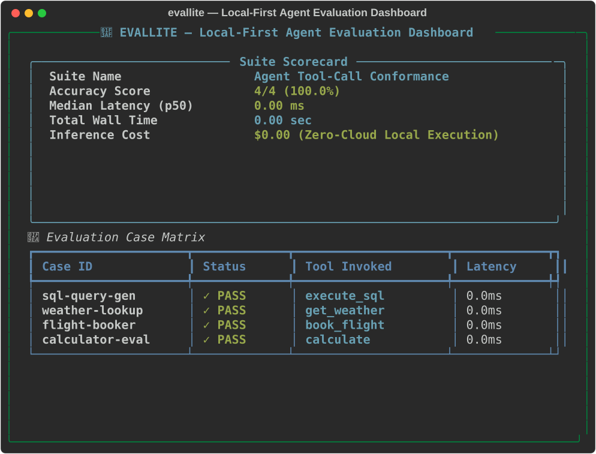

<div align="center">

# evallite ⚡

**Lightning-Fast, Local-First Agent & Tool-Call Evaluation Engine with Interactive Terminal Dashboard**

[](https://github.com/BNTiyan/evallite/actions)
[](https://www.python.org/)
[](LICENSE)
[](#)

*Detect tool hallucinations, validate argument schemas, and enforce CI/CD accuracy SLAs in < 50ms.*

<br/>



</div>

---

## Why evallite?

Most AI evaluation platforms (LangSmith, Braintrust, Phoenix) depend on remote SaaS cloud backends, introduce seconds of network latency, charge per-trace subscriptions, and require sending proprietary enterprise payloads over the internet.

`evallite` is a **100% local-first, zero-cloud-cost** evaluation engine designed specifically for function calling and agent tool execution. It detects argument hallucinations and validates tool selection schemas with deterministic sub-50ms execution speed.

| Feature | `evallite` | Cloud Eval Platforms (SaaS) | Generic Unit Tests |
| :--- | :--- | :--- | :--- |
| **Execution Latency** | **< 50ms (Pure Local)** | 1.5s - 5.0s (Network Roundtrip) | Fast |
| **Cloud Cost** | **$0.00 / Zero API Tokens** | $0.005 - $0.05 per trace | $0.00 |
| **Hallucination Detection** | **Algorithmic Parameter Diffing** | LLM-as-a-Judge (Nondeterministic) | Manual asserts |
| **Terminal Dashboard** | **Rich Real-Time Bento Table** | Web UI only | Plain text lines |
| **CI / CD Quality Gates** | **Native `--ci` Exit Codes** | Webhooks / Complex setups | Native exit codes |
| **Data Privacy** | **100% On-Prem / Local** | Payloads sent to 3rd-party SaaS | 100% On-Prem |

---

## Highlights

- **Local-First Execution**: Run entire test suites locally in under 50ms with zero cloud API token costs.
- **Tool-Call & Schema Verification**: Validate tool selection, required parameters, and strict typing.
- **Hallucination Detection**: Automatically flag unrequested, extraneous parameters injected by LLMs outside the schema.
- **Interactive Terminal Dashboard**: Real-time evaluation matrix, argument diff visualizer, and percentile latency metrics.
- **Continuous Integration (CI/CD)**: Enforce accuracy SLAs in GitHub Actions with configurable failure thresholds (`--ci`).

---

## Quick Start

### Installation

```bash
# 1-Line Standalone Install (via curl)
curl -fsSL https://raw.githubusercontent.com/BNTiyan/evallite/main/install.sh | bash

# Or install from source
git clone https://github.com/BNTiyan/evallite.git && cd evallite && pip install -e .
```

### 1. Run the Interactive Terminal Demo
```bash
evallite demo
```

### 2. Enforce CI Quality Gate
Fails with exit code 1 if accuracy drops below the designated threshold:
```bash
evallite demo --ci
```

### 3. Run Custom Evaluation Suites
```bash
evallite run suite.json --min-accuracy 95 --ci -o eval_report.json
```

---

## Use in GitHub Actions

You can drop `evallite` directly into any GitHub Actions pipeline:

```yaml
- name: Evaluate Agent Tool Calls
  uses: BNTiyan/evallite@main
  with:
    suite: 'demo'
    min-accuracy: '100'
```

---

## Suite Schema Format

Define evaluation cases cleanly in JSON or YAML:

```json
[
  {
    "id": "weather-check",
    "prompt": "What is the temperature in Paris in Celsius?",
    "expected_tool": "get_weather",
    "expected_args": {
      "city": "Paris",
      "units": "celsius"
    },
    "forbidden_args": ["auth_token", "admin_mode"],
    "assertions": ["contains:Paris"],
    "max_latency_ms": 500.0
  }
]
```

---

## Architecture

```text
┌─────────────────┐       Deterministic Diff Engine       ┌──────────────────┐
│   Agent Output  │ ────────────────────────────────────> │  evallite Engine │
│ (Tool + Args)   │ <──────────────────────────────────── │ (Schema & Diff)  │
└─────────────────┘       Hallucination & CI Status       └──────────────────┘
```

---

## Running Tests

```bash
pytest tests/ -v
```

---

## License

MIT © [BNTiyan](https://github.com/BNTiyan)
